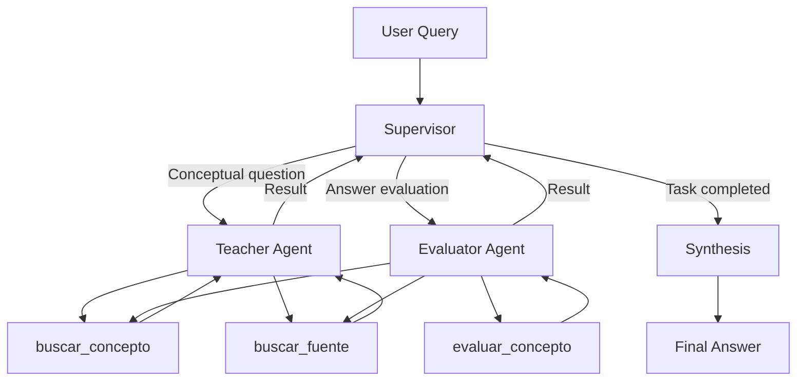

# TeMa — AI-Powered Academic Tutoring System

An AI-powered academic tutoring system for Statistics and Research Methodology, featuring multi-agent orchestration, hybrid Retrieval-Augmented Generation (RAG), semantic answer evaluation, and human-in-the-loop review.

This repository contains the AI and RAG backend of **TeMa**, built with LangGraph, FastAPI, Redis, and Pinecone. It evolves the project's original Django-based implementation into an asynchronous, multi-agent architecture.

**Previous implementation:** [TeMa — Django-based application](tema-production-31a3.up.railway.app)

---

## Overview

TeMa allows users to:

- Request explanations of concepts in Statistics and Research Methodology.
- Retrieve relevant bibliographic sources and page references.
- Submit their own answers for conceptual evaluation.
- Receive feedback and suggestions for improving their understanding.
- Participate in a human-in-the-loop review process when an evaluation requires supervision.

The system uses a hierarchical multi-agent architecture coordinated by a Supervisor. Two specialized agents handle conceptual questions and answer evaluation, respectively. Both can retrieve information from a knowledge base through a hybrid retrieval system combining lexical search and semantic similarity.

The application exposes its functionality through an asynchronous REST API. Redis manages task queues and application state, while an independent Worker executes the LangGraph workflow in the background.

LangGraph checkpointing allows workflow execution to be interrupted and resumed, supporting human review without losing the execution state.

Observability is provided through Arize Phoenix and OpenInference instrumentation. The project also includes JSON execution traces and automated tests.

## System architecture

```text
                         Client
                           |
                           v
                     FastAPI / REST
                           |
                 +---------+---------+
                 |                   |
                 v                   v
           Redis State          Task Queue
                                     |
                                     v
                                   Worker
                                     |
                                     v
                                 LangGraph
                                     |
                                 Supervisor
                                     |
                    +----------------+----------------+
                    |                                 |
                    v                                 v
              Teacher Agent                    Evaluator Agent
                    |                                 |
                    +----------------+----------------+
                                     |
                              Hybrid Retriever
                                     |
                              Knowledge Base
                                     |
                                     v
                              Human Review
                                     |
                                     v
                                  Synthesis
                                     |
                                     v
                                Final Answer
```

The diagram illustrates the main components and their functional relationships. The actual execution order depends on the Supervisor's routing decisions and the conditions defined in the graph.

---

## Multi-agent architecture

The system follows a hierarchical architecture in which a Supervisor coordinates two specialized agents:

- **Teacher Agent:** handles conceptual questions and retrieves relevant theoretical information.
- **Evaluator Agent:** assesses users' answers and provides feedback based on the retrieved knowledge.

A synthesis node integrates the agents' contributions into a final response.



### Main components

| Component | Responsibility |
|---|---|
| **FastAPI** | Receives requests and exposes processing, status, and human approval endpoints. |
| **Redis** | Stores task states and manages processing and approval queues. |
| **Asynchronous Worker** | Processes pending tasks and executes the graph outside the HTTP request lifecycle. |
| **LangGraph** | Orchestrates agents, manages workflow transitions, and supports interruption and resumption. |
| **Supervisor** | Determines which agent should handle a request and when the workflow is complete. |
| **Teacher Agent** | Retrieves theoretical information and relevant sources to answer academic questions. |
| **Evaluator Agent** | Evaluates user answers using semantic similarity and supporting knowledge retrieval. |
| **Synthesis Node** | Combines the system's contributions into a final response. |
| **Arize Phoenix** | Provides observability for instrumented executions. |
| **JSON Traces** | Preserve execution records, including messages, tool calls, and human interventions. |

## Hybrid Retrieval-Augmented Generation (RAG)

The system uses a hybrid retriever that combines two complementary retrieval mechanisms:

- **BM25 lexical search:** retrieves documents based on term matching.
- **Vector search:** uses embeddings to retrieve documents semantically similar to the query.

The results are combined through a weighted retrieval strategy to produce a ranked list of relevant documents.

This retrieval system supports the agents in finding definitions, theoretical explanations, and bibliographic references. Retrieved documents provide the knowledge base used to ground their responses.

### Retrieval and evaluation tools

| Tool | Function |
|---|---|
| `buscar_concepto` | Retrieves relevant theoretical content to explain a concept. |
| `buscar_fuente` | Retrieves bibliographic information and page numbers. |
| `evaluar_concepto` | Semantically compares the user's answer with retrieved content. |

The evaluation tool uses heuristic thresholds to assign one of four categories: `Poor`, `Incomplete`, `Good`, and `Very Good`.

These thresholds have not been empirically calibrated. Semantic similarity provides a comparison signal against the retrieved documents, but it is not, by itself, a definitive measure of the conceptual quality of an answer.

### Retriever configuration

The retriever uses LangChain's `EnsembleRetriever` to combine BM25 and vector search results.

The configuration selected based on previous experiments is:

| Parameter | Value |
|---|---:|
| Embedding model | `sentence-transformers/all-MiniLM-L6-v2` |
| Vector store | Pinecone |
| Vector similarity metric | Cosine |
| Chunk size | 400 tokens |
| Chunk overlap | 100 tokens |
| `top-k` | 5 |
| BM25 weight | 0.25 |
| Vector search weight | 0.75 |

This configuration balances lexical matching and semantic retrieval. The parameters were selected through an earlier evaluation using a specific Golden Set.

### Previous retrieval experiments

Experiments were conducted to analyze the effects of chunk size and the weighting assigned to BM25 and vector retrieval.

The evaluation used a Golden Set and the following metrics:

- **Precision@5**
- **Recall@5**

Different chunk sizes were compared while maintaining an overlap of 100 tokens.

**Important:** These results belong to an earlier version of the retrieval component. Although the retrieval strategy was retained, the architecture and agent interfaces changed during the subsequent development of the multi-agent system. Therefore, these results should not be interpreted as an evaluation of the complete current system. Reproducing them with the current code may require adapting and validating the original evaluation procedure.

#### Recall@5

Figure 1 shows Recall@5 for different combinations of BM25 and vector search weights across several chunk sizes.

**Figure 1.** Recall@5 by BM25/vector retrieval weight configuration and chunk size.


The highest Recall@5 values were obtained with chunk sizes of 500, 400, and 300 tokens, reaching 100% in several configurations. Chunk sizes of 600 tokens showed lower recall in some configurations.

These results suggest that chunk size had a relevant effect on the retriever's ability to retrieve relevant information. Performance also depended on the weighting configuration used by `EnsembleRetriever`.

**Chart note:** Some configurations produced identical Recall@5 values, causing their lines to overlap. In particular, the green and orange lines are hidden beneath the red line because they share the same values for the represented weight configurations.

#### Precision@5

Figure 2 presents Precision@5 for the same weight configurations and chunk sizes.

**Figure 2.** Precision@5 by BM25/vector retrieval weight configuration and chunk size.


The highest Precision@5 was obtained with a chunk size of 400 tokens. Precision reached its maximum with a BM25 weight of 0.25 and a vector search weight of 0.75.

#### Chunk size comparison

The aggregated results were:

| Chunk size | Precision@5 | Recall@5 |
|---:|---:|---:|
| 600 tokens | 65% | 87.5% |
| 500 tokens | 72.5% | 100% |
| 400 tokens | 80% | 100% |
| 300 tokens | 72.5% | 100% |

A chunk size of 400 tokens was selected because it achieved the highest Precision@5 while maintaining 100% Recall@5 on the evaluated Golden Set.

The resulting configuration combines a 400-token chunk size, 100-token overlap, `top-k` of 5, BM25 weight of 0.25, and vector search weight of 0.75.

These results are specific to the corpus and Golden Set used in the experiments. They do not necessarily represent retrieval performance on other document collections, nor do they independently establish the quality of the final answers generated by the agents.

## Agent orchestration

The graph is organized around a Supervisor and two specialized agents, with a synthesis node responsible for the final response.

### Supervisor

The Supervisor uses structured output through the `DecisionSupervisor` model to determine the next step in the workflow.

Possible routing decisions are:

- `profesor`
- `evaluador`
- `FINISH`

The graph also implements a maximum step limit to prevent excessive execution cycles. Agents support fallback mechanisms between configured LLM providers when applicable.

### Teacher Agent

The Teacher Agent uses retrieval tools to locate relevant information and generate explanations grounded in the knowledge base.

### Evaluator Agent

The Evaluator Agent uses `evaluar_concepto` to obtain an initial evaluation category. It can also retrieve additional theoretical content and bibliographic references.

When human feedback is received, the agent reassesses the answer using the provided observations.

## Human-in-the-loop (HITL)

When the Supervisor determines that the Evaluator Agent should be invoked, the workflow first passes through a human approval node.

```text
Supervisor
    |
    v
Human Approval
    |
    v
interrupt()
    |
    v
WAITING_APPROVAL
    |
    | POST /approve/{job_id}
    v
Redis
    |
    v
Worker
    |
    v
Command(resume=...)
    |
    v
Evaluator
    |
    +---- Review required ----> Human Approval
    |
    +---- Final evaluation ---> Supervisor
                                  |
                                  v
                               Synthesis
                                  |
                                  v
                               completed
```

The workflow uses LangGraph's `interrupt()` to pause execution and `Command(resume=...)` to resume it after receiving a human decision.

Human reviewers can:

- **Approve** the evaluation and allow the workflow to continue.
- **Reject** the evaluation and provide feedback so that the Evaluator Agent can reassess and revise its response.

Human feedback is incorporated into the subsequent evaluation and persisted alongside other intervention events.

### Synthesis

The synthesis node combines the contributions accumulated during execution to produce a clear and concise final response.

## REST API

The application exposes three main endpoints.

### `POST /process`

Receives a query, generates a unique identifier, stores the initial task state in Redis, and adds the task to the `multiagent_tasks` queue.

Example request:

```json
{
  "query": "Please evaluate my answer about correlation. Correlation is..."
}
```

Initial response:

```json
{
  "job_id": "xxxxxxxx-xxxx-xxxx-xxxx-xxxxxxxxxxxx",
  "status": "pending"
}
```

Processing continues in the background. The client uses the returned identifier to retrieve the task status.

### `GET /status/{job_id}`

Retrieves the task status, result, and any errors that may have occurred.

The workflow uses the following states:

- `pending`
- `processing`
- `waiting_approval`
- `completed`
- `failed`

### `POST /approve/{job_id}`

Receives a human decision and, optionally, feedback for the Evaluator Agent.

Example approval:

```json
{
  "decision": "approve",
  "feedback": ""
}
```

Example rejection with feedback:

```json
{
  "decision": "reject",
  "feedback": "Review the explanation and add an applied example."
}
```

The endpoint verifies that the task exists and is waiting for approval. It then stores the decision in Redis and adds it to the `multiagent_approvals` queue. The Worker retrieves the information and resumes the graph.

Interactive API documentation is available at `/docs` while the server is running.

## Asynchronous processing and state persistence

The architecture decouples request handling from agent execution.

The main task queue uses the `multiagent_tasks` key, while approval events are processed through `multiagent_approvals`. Each task's state is stored under `task_status:{job_id}`.

The graph is compiled with `AsyncRedisSaver`, which persists checkpoints associated with the conversation identifier (`thread_id`). This allows workflow execution to resume after a Human-in-the-loop interruption.

The Worker updates the task status according to the processing result. If an exception occurs, it records the error and marks the task as `failed`.

## Observability and execution traces

Instrumentation uses Arize Phoenix, OpenInference, and OpenTelemetry to monitor system executions.

Phoenix allows developers to inspect traces and instrumented spans, follow the observable execution sequence, and analyze available latency and cost metrics.

The system also stores local traces in JSON format. Depending on the execution path, these may include:

- User messages and agent responses.
- Tool calls and their results.
- Identification of the agents involved.
- Human approval events and feedback.
- Observable execution sequence.

These traces represent the observable execution of the system, not the models' unobservable internal reasoning.

Phoenix instrumentation uses the local endpoint:

- Traces: `http://localhost:6006/v1/traces`
- Web interface: `http://localhost:6006`

The repository includes **five example traces** in `traces/` and screenshots in `screenshots/`, illustrating system executions and the cost and latency metrics observed in Arize Phoenix.

## Error handling

The project implements error handling across tool execution, agent workflows, and the Worker.

LLM provider errors are classified through the mechanisms defined in `app/errors.py`. Agents support fallback between configured providers, while errors that prevent task completion are recorded in the task state.

Error information is available through `GET /status/{job_id}`.

## Automated tests

The project includes an automated test suite covering the API, Worker, checkpointing, Human-in-the-loop workflows, and other implemented components.

The test suite was successfully executed in the development environment, with **39 tests passing**.

**Important:** Development dependencies must be installed and the application must be running through `run.sh` before executing the tests. Some tests require actual services to be available, so running the test suite in isolation is not sufficient.

### Running the tests

1. Open a terminal in the project root.
2. Activate the virtual environment.
3. Install the development dependencies:

   ```bash
   python -m pip install -r requirements-dev.txt
   ```

4. Start the application:

   ```bash
   bash run.sh
   ```

5. Wait until Redis, Phoenix, FastAPI, and the Worker are available.
6. Keep this terminal running while the tests execute.
7. Open a second terminal, activate the same virtual environment, and run:

   ```bash
   python -m pytest -v
   ```

When testing is complete, stop the application with `Ctrl+C` in the terminal running `run.sh`. Redis and Phoenix remain active in Docker and can be stopped separately.

## Requirements

To run the project, you need:

- Python 3.12 or a compatible version supported by the project dependencies.
- Docker and Docker Compose.
- Redis, started through `compose.yml`.
- Access to the Pinecone index used by the retriever.
- An API key for the configured LLM provider.
- Arize Phoenix for observability.
- The Python dependencies declared in `requirements.txt`.

API keys for alternative providers are required if you intend to use the corresponding fallback mechanisms.

## Installation and configuration

### 1. Clone the repository

```bash
git clone <REPOSITORY_URL>
cd <REPOSITORY_DIRECTORY>
```

Replace `<REPOSITORY_URL>` with the repository URL.

### 2. Create and activate a virtual environment

Create the environment:

```bash
python -m venv .venv
```

On Windows PowerShell:

```powershell
.\.venv\Scripts\Activate.ps1
```

On Linux or macOS:

```bash
source .venv/bin/activate
```

### 3. Install dependencies

```bash
python -m pip install -r requirements.txt
```

### 4. Configure environment variables

Create a `.env` file using `.env.example` as a reference, and provide the required credentials.

```dotenv
# Models
GOOGLE_API_KEY=your_google_api_key
OPENAI_API_KEY=your_openai_api_key
ANTHROPIC_API_KEY=your_anthropic_api_key

# Database
PINECONE_API_KEY=your_pinecone_api_key
INDEX_NAME=your_index_name

# Redis
REDIS_URL=redis://localhost:6379
```

The variable names must match those used in the current project configuration. Never commit actual credentials to the repository.

### 5. Start the application

The `run.sh` script automates the startup of the services and processes required to run the application in the Windows environment used during development.

From the project root, execute:

```bash
bash run.sh
```

The script performs the following operations:

1. Activates the Python virtual environment through `.venv/Scripts/activate`.
2. Starts Redis and Phoenix using Docker Compose and `compose.yml`.
3. Waits until Redis responds successfully.
4. Configures `REDIS_URL`, using `redis://localhost:6379` as the default value.
5. Starts FastAPI through Uvicorn with `--reload`.
6. Starts the Worker using `python -m app.worker`.
7. Waits until FastAPI is available and automatically opens Swagger in Windows when the API responds within the configured timeout.

Main service addresses:

| Service | Address |
|---|---|
| API and Swagger | [http://127.0.0.1:8000/docs](http://127.0.0.1:8000/docs) |
| OpenAPI schema | [http://127.0.0.1:8000/openapi.json](http://127.0.0.1:8000/openapi.json) |
| Phoenix | [http://localhost:6006](http://localhost:6006) |

To stop FastAPI and the Worker, press `Ctrl+C` in the terminal running the script. Redis and Phoenix remain active in Docker.

**Operating system note:** The `run.sh` script described here uses Windows-specific paths and commands, including `.venv/Scripts/activate`, `taskkill.exe`, and `explorer.exe`.

A separate shell script for Linux is also included. However, **the Linux alternative has not been tested**, so its behavior on that operating system remains unverified.

## Example usage

1. Start the application using `run.sh`. The script automatically opens Swagger when the API becomes available.
2. If Swagger does not open automatically, navigate to [http://127.0.0.1:8000/docs](http://127.0.0.1:8000/docs).
3. Submit a query through `POST /process`.
4. Copy the `job_id` returned in the response.
5. Poll `GET /status/{job_id}`, replacing `{job_id}` with the copied identifier, until the task completes or requires approval.
6. If the status is `waiting_approval`, submit a decision through `POST /approve/{job_id}`.
7. Check the task status again until the final result is available.
8. Inspect the execution in Phoenix and review the corresponding JSON trace.

### Example video

[Watch the example video](https://drive.google.com/file/d/1KVr_MlY7GyNQnINE-KtGg30BUCunMZRB/view?usp=sharing)

## Technologies

- Python
- FastAPI and Uvicorn
- asyncio
- Pydantic
- Redis
- LangChain and LangGraph
- LangGraph Checkpoint Redis
- Configured LLM providers
- Pinecone
- Embeddings and vector retrieval
- BM25 and hybrid retrieval
- scikit-learn
- Arize Phoenix
- OpenInference and OpenTelemetry
- pytest
- Docker Compose
- Git

## Project structure

The main functional structure is:

```text
.
├── app/
│   ├── agents/
│   │   ├── profesor.py
│   │   ├── evaluador.py
│   │   ├── supervisor.py
│   │   └── sintesis.py
│   ├── chunking.py
│   ├── db_config.py
│   ├── db_ingest.py
│   ├── logging_config.py
│   ├── main.py
│   ├── models.py
│   ├── worker.py
│   ├── graph_config.py
│   ├── schemas.py
│   ├── tools.py
│   ├── retriever.py
│   ├── errors.py
│   ├── hitl.py
│   ├── observability.py
│   ├── setup.py
│   └── trace_utils.py
├── tests/
├── traces/
├── screenshots/
├── evaluation/
│   └── retrieval/
│       ├── golden_set.json
│       ├── figures.ipynb
│       ├── results/
│       │   ├── preentrega4_datos_precision.csv
│       │   └── preentrega4_datos_recall.csv
│       └── figures/
│           ├── recall_at_5.png
│           └── precision_at_5.png
├── .env.example
├── compose.yml
├── requirements.txt
├── run.sh
├── run_linux.sh
└── README.md
```

The structure is illustrative and should be updated to match the files present in the final repository. Evaluation charts must retain the relative paths shown above to render correctly on GitHub.

## Design decisions

The main architectural decisions include:

- Separating HTTP request handling from background processing.
- Using Redis to decouple task submission from execution and to persist task states.
- Using graph checkpoints to preserve execution state across interruptions.
- Coordinating specialized agents through a Supervisor.
- Implementing hybrid retrieval over a dedicated knowledge base.
- Supporting Human-in-the-loop review and feedback-driven reevaluation.
- Maintaining explicit task states and error handling.
- Instrumenting executions to facilitate debugging and analysis.
- Preserving detailed execution traces.
- Automating validation through an automated test suite.
- Automating service startup through `run.sh`.

## Acknowledgements and references

The development of this project drew on:

- The original TeMa implementation, which provided the starting point for the application's evolution.
- Technical examples and educational materials covering agents, LangGraph, tools, RAG, and multi-agent systems.
- Official documentation and publicly available technical resources.
- ChatGPT as a development assistance tool.
